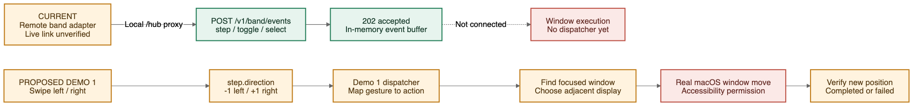

# Demo 1 Workflow and Remaining Work

## Status

The published gesture intake was checked at commit `6ed58ed` on `codex/api`.
This document is an implementation assessment and a proposal, not a claim that
real window movement or a new gesture mapping has been implemented.

Demo 1 means moving the same live focused application window between two
extended displays attached to one Mac. It does not copy a screenshot, move a
whole desktop/Space, or send a window to another Mac.

## What works today

The HTTP API registers a band adapter, accepts `step`, `toggle`, and `select`,
validates inputs, deduplicates keyed retries, and returns `202 accepted`.
Events are buffered in memory. No window command is dispatched from that buffer.

The source band SDK and its official simulator are available. The API branch's
`RealVexoInput` is still a hardware adapter boundary, not a working classifier.
However, remote branch `vexoband` at `5031463` already provides a browser adapter,
gesture recognizer, `hub.js` HTTP client, and `serve.py` proxy. That code was
inspected read-only; it was not merged, changed, run, or hardware-validated here.

Its intended route is band BLE -> browser adapter -> same-origin `/hub` proxy
on the local dashboard server -> Mac API on port 8000. The proxy adds the session
token and forwards retry keys; this avoids requiring cross-origin browser access
to the API. The band client handles registration and posts unchanged event bodies.
Its default detector currently uses wrist tilt to emit `step` with -1 or 1; confirm
the physical gesture with the band owner, rather than changing the HTTP meaning.
The older optional adjustment mode and copied schema still mention `adjust`,
which the updated API rejects. The default mode does not send that event.

The separate WebSocket/iPhone route supports `window.capture` and `window.move`
messages, but uses the older `grab`/`throw` interaction. Its simulated window
controller stores a token and checks that the token exists; it does not move a
real window. The real `MacOSWindowController` methods still raise errors saying
AX window capture and movement are not implemented.

The iPhone shell has a coordinator and Mac WebSocket bridge, but its Mentra target
acquisition is mocked. The new HTTP `step`/`toggle`/`select` inputs do not feed that
coordinator. A photo upload does not automatically select a device.

## Minimal proposed route

```text
Band swipe -> band adapter -> Mac HTTP input -> Demo 1 dispatcher
           -> focused window and display lookup -> real window move
           -> position verification -> completed/failed status
```

The proposed business mapping is explicit and limited to Demo 1:

- `step` with `direction: -1`: move the focused window to the display on its left.
- `step` with `direction: 1`: move the focused window to the display on its right.
- Select the destination using the physical display arrangement, not an assumed
  display index or a rule that `1` always means the external monitor.
- With no display in that direction, return a clear no-target result rather than
  moving an arbitrary window or silently wrapping around.
- Keep `toggle` and `select` accepted, but do not silently give them window actions.
  Neither glasses-based selection nor the old grab/throw interaction is required
  for this minimal swipe-to-move demo.

This mapping is a proposal. The device-level contract defines physical direction;
it does not itself specify a window-management action.

## Missing components

| Component | Remaining work |
| --- | --- |
| Band integration | Connect the existing remote browser/proxy adapter to the Mac API and verify BLE ownership, reconnection, calibration, and left/right orientation end to end |
| Dispatcher | Consume a newly accepted gesture, apply the Demo 1 mapping, keep the same window reference throughout the action, and avoid treating retries as new movement |
| Window lookup | Request/check macOS Accessibility permission and obtain the focused movable window; reject unsupported windows cleanly |
| Display selection | Enumerate extended displays, locate the source window's display, and select an adjacent display from the actual arrangement |
| Window executor | Implement the real window-controller methods, translate coordinates correctly, and keep the same window visible on the target display |
| Result feedback | Distinguish accepted, executing, completed, and failed; verify the resulting window position instead of reporting success from a mock acknowledgement |

Glass capture, QR recognition, an iPhone coordinator, and voice are not needed for
the minimal route above. They become dependencies only if the team instead chooses
the fuller `LOOK -> GRAB -> LOOK -> THROW` profile in `TARGET.md`.

## Suggested implementation order

1. Make a local test action move a real focused window between the two displays,
   without band input. Verify permissions, geometry, unsupported windows, and
   direction with real hardware.
2. Connect the HTTP event path to that same executor through a small dispatcher.
   Keep `202 accepted` separate from the eventual result and preserve retry safety.
3. Replace manual/mock event injection with the band owner's actual swipe adapter.
4. Add clear failure feedback and verify the full gesture-to-window demo.

For a successful demo, one swipe moves the intended live window once, a repeated
delivery does not move it again, a reverse swipe works when a display exists, and
missing permission/display/window produces an explicit failure.

## Diagram

Green nodes are implemented intake behavior. Amber nodes are proposed behavior or
integration not yet verified. Red nodes mark the execution gap and real move stub.


The [Mermaid source](diagrams/demo1-workflow.mmd) has
[SVG](diagrams/demo1-workflow.svg) and [PNG](diagrams/demo1-workflow.png) renders,
plus an [editable Excalidraw scene](diagrams/demo1-workflow.excalidraw).
